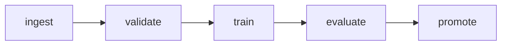

# Evidence of runs

Recorded 2026-10-29 on a local kind cluster (Kubernetes v1.36.4, Argo Workflows v4.1.6). Produced by
`tests/workflow/run-scenarios.sh` (4 min 12 s, all checks passed) and
`tests/workflow/security-checks.sh --restart-node`.

## Workflow DAG

## Runs

| Scenario | Run | Outcome | Attempts per stage | Registry |
|---|---|---|---|---|
| Success | `churn-training-wjfrq` | Succeeded | each stage once, exit 0 | `current.json` points at this run |
| Invalid data | `churn-training-btxnp` | Failed at validate | validate once, exit 10 (no retry); train, evaluate, promote never started | unchanged |
| Failed training | `churn-training-bphvb` | Failed at train | train 3 times, all exit 1 (1 + 2 retries); evaluate, promote never started | unchanged |
| Failed gate | `churn-training-b9wwt` | Failed at evaluate | evaluate once, exit 20 (no retry); promote never started; `gate.json` has `passed: false` | unchanged |
| Timeout | `churn-training-9s45h` | Failed at train | train once, no exit code, "longer than the specified deadline", retry expression evaluated to false; evaluate, promote never started | unchanged |

"Unchanged" means the SHA-256 of `registry/current.json` and the list of `registry/models/` were
identical before and after, and no `registry/models/<run>` exists for the failed run.

These workflow objects live in the local cluster and disappear with it (`scripts/cleanup.sh`).

## Not shown by these runs

- Exit code 30 end to end on the cluster (covered by unit tests only).
- The GitHub Actions workflow itself: its steps were run locally, but it has not run on GitHub.
- Behavior with datasets larger than the 5,000-row fixture.
