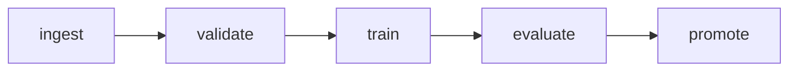

# Evidence of runs

Recorded 2026-10-29 on a local kind cluster (Kubernetes v1.36.4, Argo Workflows v4.1.6, Calico v3.33.0), freshly rebuilt with `scripts/cleanup.sh` and the documented setup. Produced by `tests/workflow/run-scenarios.sh` (all checks passed) and `tests/workflow/security-checks.sh --restart-node` (all checks passed, including the node-restart check).

## Workflow DAG

## Runs

| Scenario | Run | Outcome | Attempts per stage | Registry |
|---|---|---|---|---|
| Success | `churn-training-rp6s6` | Succeeded | each stage once, exit 0 | `current.json` points at this run |
| Invalid data | `churn-training-f2s95` | Failed at validate | validate once, exit 10 (no retry); train, evaluate, promote never started | unchanged |
| Failed training | `churn-training-zc5kp` | Failed at train | train 3 times, all exit 1 (1 + 2 retries); evaluate, promote never started | unchanged |
| Failed gate | `churn-training-4mgf5` | Failed at evaluate | evaluate once, exit 20 (no retry); promote never started; `gate.json` has `passed: false` | unchanged |
| Timeout | `churn-training-fvlg9` | Failed at train | train once, no exit code, "longer than the specified deadline", retry expression evaluated to false; evaluate, promote never started | unchanged |
| Missing upstream artifact | `churn-training-vhkqk` | Failed at evaluate | `evaluate` submitted alone (`--entrypoint evaluate`), so `train.json` is absent: exit 30 once, no retry, log says "required artifact missing"; promote never started | unchanged |

"Unchanged" means the SHA-256 of `registry/current.json` and the list of `registry/models/` were
identical before and after, and no `registry/models/<run>` exists for the failed run.

These workflow objects live in the local cluster and disappear with it (`scripts/cleanup.sh`).

## CI

GitHub Actions run 40942671088 (manual dispatch with the cluster job enabled, 2026-10-29): `static` and
`cluster` both succeeded. In `cluster`, the security checks and all six scenarios (success and five failures) passed on a fresh kind
cluster on a GitHub-hosted runner (about 9 min, with Calico and the network and token checks). The same workflow ran on push and `static` passed.

## Resource simulations

`tests/perf/run.sh` runs the five stages on synthetic datasets in the stage image, read-only, no
network, all capabilities dropped, and reads each stage's peak memory and CPU time from the kernel.
The 5,000-row row reproduces the earlier measurements (126, 137, 266, 263, 123 MiB).

| Rows | ingest MiB | validate MiB | train MiB | evaluate MiB | promote MiB | train CPU s (avg cores) |
|---|---|---|---|---|---|---|
| 5,000 | 126 | 137 | 266 | 263 | 124 | 5.0 (2.1) |
| 50,000 | n/a | 160 | 316 | 290 | 124 | 10.8 (3.8) |
| 500,000 | 379 | 352 | 719 | 489 | 124 | 20.2 (2.9) |
| 1,000,000 | 617 | 507 | killed at 768Mi | n/a | n/a | n/a |
| 2,000,000 | 1,110 | 950 | 1,987 | 1,103 | 123 | 53.9 (3.0) |

"n/a" means not recorded for that size. The 1M row ran under `MEMORY=768m CPUS=2`, the old train
limits: ingest and validate completed, then train was SIGKILLed (OOM) at 838 MiB. At 500k rows with a
1 CPU limit train took 11.1 s against 9.9 s with 2 CPUs.

On the cluster, `tests/workflow/large-dataset.sh 2000000` ran the whole workflow under the new limits
and every stage succeeded (run `churn-training-j64pb`: ingest 15 s, validate 8 s, train 28 s, evaluate
12 s, promote 5 s). These larger runs are not part of `run-scenarios.sh` or CI.

## Not shown by these runs

- The cluster CI job on pull requests: it runs only when started by hand.
- Datasets beyond 2,000,000 rows, or real (non-synthetic) data, whose shape may use more memory per row.
